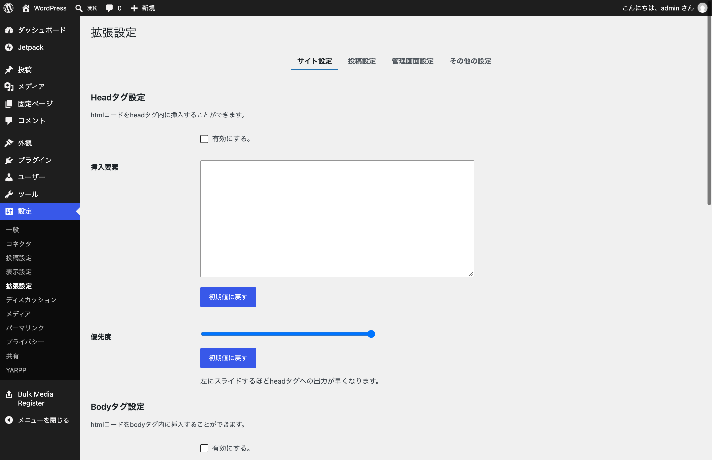

# Sketchpad modified - Plugin

## Description
We'll add features that aren't included in WordPress's standard functionality.

## Features
* Site setting       (Insert html into head and body tag.)
* Post setting       (Extend article and page title.)
* Admin page setting (Set an background image for the admin page.)
* Other setting      (Add a eye-catch for RSS feeds, disable EditURI meta link.)

## Translation
* Japanese (ja)
